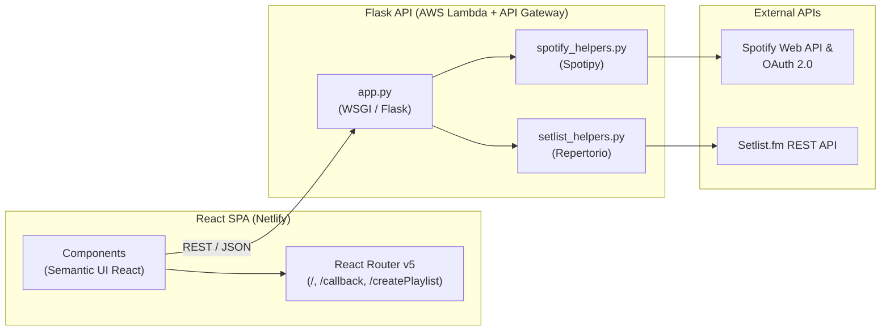

# Architecture

## System Overview

**Setlistify** is a full-stack web application that bridges **Spotify** and **Setlist.fm**. Users authenticate with their Spotify account, search for an artist, choose one of the artist's past concert setlists, and generate a Spotify playlist containing the songs performed at that concert.



---

## Technology Stack

### Frontend (`/src`)
* **Language**: TypeScript (`~4.9.5`)
* **Framework**: React 16 (`^16.13.1`) bootstrapped with Create React App (`react-scripts` 5.0.1)
* **Routing**: React Router DOM v5 (`react-router-dom` `^5.2.0`)
* **UI Component Library**: Semantic UI React (`semantic-ui-react` `^0.88.2`) + Semantic UI CSS (`2.4.1`)
* **Testing**: Jest + React Testing Library (`@testing-library/react`)
* **Runtime & Package Management**: Node.js 22 (`.nvmrc`), Yarn 4 (`yarn@4.17.0`)

### Backend (`/flask-app`)
* **Language & Runtime**: Python 3.11
* **Web Framework**: Flask (`>=3.0.0`), Flask-CORS (`>=6.0.5`), Flask-Session (`>=0.8.0`)
* **Authentication & Tokens**: PyJWT (`>=2.13.0`) for HS256-signed client tokens wrapping Spotify OAuth tokens
* **External SDKs**:
  * `spotipy` (`>=2.25.0`) — Spotify OAuth2 and Web API client
  * `repertorio` (`0.0.1`) — Setlist.fm API client
* **Configuration**: `python-decouple` and `python-dotenv`

### Hosting & Infrastructure
* **Frontend**: **Netlify** — configured via `netlify.toml` (`yarn build`, publishes `build/`).
* **Backend**: **AWS Lambda + API Gateway** (`us-east-1`) — deployed via the **Serverless Framework** (`flask-app/serverless.yml`) using `serverless-wsgi` and `serverless-python-requirements`.

---

## Core Architectural Patterns

### 1. Client-Side Routing & Authentication Flow
Routing is managed in `src/components/app_routing.tsx` using `react-router-dom` v5 `<Switch>`:
1. **`/` (Landing / Login)**:
   * On mount, `AppRouting` calls `GET /authUrl` on the backend.
   * The backend initializes `spotipy.oauth2.SpotifyOAuth` with a unique per-request cache file (`/.spotipyoauthcache<uuid>`) and returns `{ authUrl, cachePath }`.
   * Unauthenticated users see `<Login />` with a button linking to Spotify's OAuth authorization page.
2. **`/callback` (OAuth Callback)**:
   * Spotify redirects back to `/callback?code=...`.
   * `<LoginHandler />` extracts `code` from the query string and sends `POST /getUser` with `{ code, cache_path }`.
   * The backend exchanges the authorization code for a Spotify access token, encodes the token payload as an HS256 JWT signed with `APP_SECRET_KEY`, fetches the current Spotify user profile, and returns `{ user, token }`.
   * The client stores `user` and `token` in React state and redirects to `/createPlaylist`.
3. **`/createPlaylist` (Main Application View)**:
   * Protected in client state by `isLoggedIn` (redirects to `/` if unauthenticated).
   * Renders `<CreatePlaylistContainer token={token} />`.

### 2. Artist Search & Setlist Disambiguation
Because artist names on Spotify and Setlist.fm can collide across multiple acts or venues:
1. **Autocomplete (`POST /artistSearch`)**: Queries Spotify's search API (`artist:<query>`) so users select a canonical Spotify artist (with image, genres, follower count, and Spotify ID).
2. **Setlist Resolution (`POST /artistSetlists`)**:
   * Searches Setlist.fm artists sorted by relevance (`setlistApi.artists(artistName=..., sort='relevance')`).
   * Prioritizes exact case-insensitive name matches and inspects up to 3 top candidate MusicBrainz IDs (`mbid`) to find a candidate with non-empty song setlists (`setlist_has_songs`).
   * Returns `{ artistSetlists, artistMbid }` so the frontend retains the resolved `artistMbid` for playlist generation.
   * Falls back to `setlistApi.setlists(artistName=...)` filtered by artist name if candidate lookup yields no results.

### 3. Playlist Generation (`POST /buildPlaylist`)
1. Receives `{ token, artistName, artistId, playlistType, playlistId, artistMbid }`.
2. Decodes the JWT to retrieve the user's Spotify `access_token`.
3. Fetches the specific concert directly by its Setlist.fm ID (`setlistApi.setlist(pk=playlistId)`) and flattens songs across all sets and encores via `extract_songs_from_setlist()` in `flask-app/setlist_helpers.py` (with fallback to `pick_setlist_by_id()`).
4. Creates a new public playlist named `"<Artist>'s Setlist from <Date>"` on the user's Spotify account (`createPlaylist` in `flask-app/spotify_helpers.py`).
5. Resolves each song title + artist name to a Spotify track URI (`insertSongsIntoPlaylist`) and adds all matched tracks to the created playlist, returning `{ playlistUri }`.

### 4. Environment & API Boundary (`dev` vs `prod`)
* **Frontend**: `src/utils/dev_env.ts` exports `fetchUrl()`:
  * When `process.env.REACT_APP_ENV === 'dev'`, `fetchUrl()` returns `''`, routing requests through Create React App's local dev proxy (`"proxy": "http://localhost:5000"` in `package.json`).
  * Otherwise, it returns the production AWS API Gateway URL (`https://aahxozyk09.execute-api.us-east-1.amazonaws.com/dev`).
* **Backend**: `flask-app/config.py` checks `IS_OFFLINE`:
  * When `IS_OFFLINE=true`, sessions and Spotipy OAuth cache files are written to local relative folders (`./flask_session`, `./.cache`), and `REDIRECT_URI` points to `http://127.0.0.1:3000/callback`.
  * In AWS Lambda (`IS_OFFLINE=false`), writable state is stored in `/tmp/flask_session` and `/tmp/.cache`, and `REDIRECT_URI` points to `https://setlistify.app/callback`.

---

## Directory Structure

```text
setlistify-app/
├── .agents/
│   ├── rules/
│   │   └── coding-standards.md        # Project-wide agent rules
│   └── skills -> ~/Documents/develop/.agents/skills # Symlink to shared skills repo
├── .github/
│   └── workflows/                     # GitHub Actions CI workflows
├── flask-app/
│   ├── app.py                         # Flask application & REST endpoints
│   ├── config.py                      # Environment variables & OAuth config
│   ├── setlist_helpers.py             # Setlist.fm response extraction helpers
│   ├── spotify_helpers.py             # Spotify playlist & track lookup helpers
│   ├── requirements.txt               # Python package dependencies
│   ├── serverless.yml                 # Serverless Framework AWS Lambda config
│   └── package.json                   # Serverless Node plugins
├── plans/                             # Feature and refactoring plans
├── public/
│   ├── index.html                     # HTML entry point (loads Semantic UI CSS)
│   └── manifest.json                  # Web app manifest
├── src/
│   ├── components/
│   │   ├── app_routing.tsx            # Client routes & initial authUrl fetch
│   │   ├── artist_card.tsx            # Selected artist summary card
│   │   ├── basic_header.tsx           # Simple header component
│   │   ├── create_playlist_container.tsx # Main playlist creation workflow state
│   │   ├── error_message.tsx          # Error display component
│   │   ├── footer.tsx                 # Page footer component
│   │   ├── header_card.tsx            # Top navigation/user header card
│   │   ├── loading_placeholder.tsx    # Semantic UI loading skeleton
│   │   ├── login.tsx                  # Landing view with Spotify login button
│   │   ├── login_handler.tsx          # /callback OAuth code handler
│   │   ├── not_found.tsx              # 404 route fallback
│   │   ├── playlist_builder_buttons.tsx # Playlist type selector & submit button
│   │   └── search_container.tsx       # Artist search & concert setlist dropdowns
│   ├── img/
│   │   └── logo.png                   # Setlistify brand logo
│   ├── utils/
│   │   └── dev_env.ts                 # API base URL helper (dev proxy vs prod)
│   ├── App.css                        # Root layout styles
│   ├── App.test.tsx                   # Root component tests
│   ├── App.tsx                        # Top-level App shell
│   ├── index.css                      # Global typography and body resets
│   └── index.tsx                      # React mounting entry point
├── ARCHITECTURE.md
├── README.md
├── netlify.toml
├── package.json
└── tsconfig.json
```
