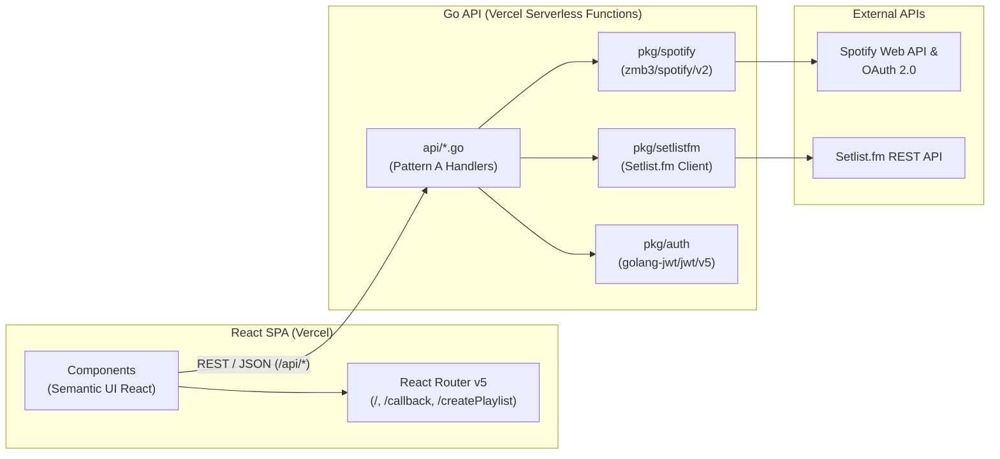

# Architecture

## System Overview

**Setlistify** is a full-stack web application that bridges **Spotify** and **Setlist.fm**. Users authenticate with their Spotify account, search for an artist, choose one of the artist's past concert setlists, and generate a Spotify playlist containing the songs performed at that concert.



---

## Technology Stack

### Frontend (`/src`)
* **Language**: TypeScript (`~4.9.5`)
* **Framework**: React 16 (`^16.13.1`) bootstrapped with Create React App (`react-scripts` 5.0.1)
* **Routing**: React Router DOM v5 (`react-router-dom` `^5.2.0`)
* **UI Component Library**: Semantic UI React (`semantic-ui-react` `^0.88.2`) + Semantic UI CSS (`2.4.1`)
* **Testing**: Jest + React Testing Library (`@testing-library/react`)
* **Runtime & Package Management**: Node.js 22 (`.nvmrc`), Yarn 4 (`yarn@4.17.0`)

### Backend (`/api`, `/pkg`)
* **Language & Runtime**: Go 1.22+ (`go.mod`)
* **Handler Architecture**: Pattern A (pure domain functions wired through `httputil.Handle[Req, Res]` generic adapter)
* **Authentication**: `github.com/golang-jwt/jwt/v5` for HS256-signed JWT tokens
* **External SDKs**:
  * `github.com/zmb3/spotify/v2` & `golang.org/x/oauth2` — Spotify OAuth2 and Web API client
  * Native HTTP client for Setlist.fm REST API (`pkg/setlistfm`)
* **Local Dev Server**: `cmd/devserver/main.go`

### Hosting & Infrastructure
* **Vercel Monorepo**: Hosts both the frontend static build and the backend Go serverless functions under `https://www.setlistify.app`.
  * **Frontend**: React SPA built via `yarn build` into `/build`.
  * **Backend**: Serverless Functions in `/api` compiled by Vercel's Go builder.
  * **Routing & Headers**: Configured via `vercel.json` for client-side routing rewrites and API CORS policies.

---

## Core Architectural Patterns

### 1. Client-Side Routing & Authentication Flow
Routing is managed in `src/components/app_routing.tsx` using `react-router-dom` v5 `<Switch>`:
1. **`/` (Landing / Login)**:
   * On mount, `AppRouting` calls `GET /authUrl` on the backend.
   * The backend generates a Spotify OAuth authorization URL and returns `{ authUrl, cachePath }`.
   * Unauthenticated users see `<Login />` with a button linking to Spotify's OAuth authorization page.
2. **`/callback` (OAuth Callback)**:
   * Spotify redirects back to `/callback?code=...`.
   * `<LoginHandler />` extracts `code` from the query string and sends `POST /api/getUser` with `{ code }`.
   * The backend exchanges the authorization code for a Spotify access token, encodes the token payload as an HS256 JWT signed with `APP_SECRET_KEY`, fetches the current Spotify user profile, and returns `{ user, token }`.
   * The client stores `user` and `token` in React state and redirects to `/createPlaylist`.
3. **`/createPlaylist` (Main Application View)**:
   * Protected in client state by `isLoggedIn` (redirects to `/` if unauthenticated).
   * Renders `<CreatePlaylistContainer token={token} />`.

### 2. Artist Search & Setlist Disambiguation
Because artist names on Spotify and Setlist.fm can collide across multiple acts or venues:
1. **Autocomplete (`POST /api/artistSearch`)**: Queries Spotify's search API (`artist:<query>`) so users select a canonical Spotify artist (with image, genres, follower count, and Spotify ID).
2. **Setlist Resolution (`POST /api/artistSetlists`)**:
   * Searches Setlist.fm artists sorted by relevance using `pkg/setlistfm`.
   * Prioritizes exact case-insensitive name matches and inspects candidate MusicBrainz IDs (`mbid`) to find a candidate with non-empty song setlists.
   * Returns `{ artistSetlists, artistMbid }` so the frontend retains the resolved `artistMbid` for playlist generation.

### 3. Playlist Generation (`POST /api/buildPlaylist`)
1. Receives `{ token, artistName, artistId, playlistType, playlistId, artistMbid }`.
2. Decodes the JWT via `pkg/auth` to retrieve the user's Spotify access token.
3. Fetches the specific concert directly by its Setlist.fm ID via `pkg/setlistfm` and flattens songs across all sets and encores.
4. Creates a new public playlist named `"<Artist>'s Setlist from <Date>"` on the user's Spotify account via `pkg/spotify`.
5. Resolves each song title + artist name to a Spotify track URI and adds all matched tracks to the created playlist, returning `{ playlistUri }`.

### 4. Environment & API Boundary (`dev` vs `prod`)
* **Unified Same-Origin Routing**: `src/utils/dev_env.ts` exports `fetchUrl()`, which returns `'/api'`.
  * In production on Vercel, requests to `/api/*` are handled directly by the corresponding Go serverless functions in `api/`.
  * In local development, the React dev server proxies `/api/*` requests to the Go dev server (`http://localhost:5001`) via `"proxy": "http://localhost:5001"` in `package.json`.
* **Stateless Token-Based Backend**:
  * The Go backend is completely stateless; no server-side sessions, temporary files, or local OAuth token caches are required. User credentials and access tokens are passed via client JWTs signed with `APP_SECRET_KEY`.

### 5. Go Serverless Handler Architecture (Pattern A)
The Go Vercel serverless functions in `api/*.go` separate HTTP transport lifecycle concerns from pure domain logic:
1. **Generic Handler Adapter (`pkg/httputil/adapter.go`)**:
   - `httputil.Handle[Req, Res](method, fn)` wraps a pure business logic function `func(ctx, cfg, req) (res, error)`.
   - Automates CORS preflight (OPTIONS 204), HTTP method checks (405), configuration loading, JSON decoding for non-GET requests (400), and structured error/success JSON writing.
   - Translates `httputil.APIError` into specific HTTP status codes and error type payloads (falling back to 500 `ServerError`).
2. **Pure Domain Functions**:
   - Reside in the `api/` package alongside the exported entry point (e.g. `resolveArtistSetlists`, `searchArtists`, `buildPlaylist`).
   - Accept typed DTO requests, context, and config; return typed DTO responses and errors.
   - Fully testable in isolation without mocking `http.ResponseWriter` or HTTP request streams.
3. **Vercel Entry Points**:
   - Retain standard signature `func(w http.ResponseWriter, r *http.Request)`.
   - Single-line delegates to `httputil.Handle(method, businessFunc)(w, r)`.


---

## Directory Structure

```text
setlistify-app/
├── .agents/
│   └── skills -> ~/Documents/develop/.agents/skills # Symlink to shared skills repo
├── .github/
│   └── workflows/                     # GitHub Actions CI workflows
├── api/                               # Go Vercel serverless entry points (Pattern A)
│   ├── artistSearch.go
│   ├── artistSetlists.go
│   ├── authUrl.go
│   ├── buildPlaylist.go
│   ├── getUser.go
│   ├── setlistArtists.go
│   └── handlers_test.go
├── cmd/
│   └── devserver/                     # Local standalone Go dev server
├── pkg/
│   ├── auth/                          # JWT token encoding & decoding
│   ├── config/                        # Environment & config loading
│   ├── httputil/                      # CORS, JSON, and generic adapter Handle[Req, Res]
│   ├── setlistfm/                     # Setlist.fm client & setlist resolution
│   └── spotify/                       # Spotify service, user client, & playlist creation
├── plans/                             # Feature and refactoring plans
├── public/
│   ├── index.html                     # HTML entry point (loads Semantic UI CSS)
│   └── manifest.json                  # Web app manifest
├── src/
│   ├── components/
│   │   ├── app_routing.tsx            # Client routes & initial authUrl fetch
│   │   ├── artist_card.tsx            # Selected artist summary card
│   │   ├── basic_header.tsx           # Simple header component
│   │   ├── create_playlist_container.tsx # Main playlist creation workflow state
│   │   ├── error_message.tsx          # Error display component
│   │   ├── footer.tsx                 # Page footer component
│   │   ├── header_card.tsx            # Top navigation/user header card
│   │   ├── loading_placeholder.tsx    # Semantic UI loading skeleton
│   │   ├── login.tsx                  # Landing view with Spotify login button
│   │   ├── login_handler.tsx          # /callback OAuth code handler
│   │   ├── not_found.tsx              # 404 route fallback
│   │   ├── playlist_builder_buttons.tsx # Playlist type selector & submit button
│   │   └── search_container.tsx       # Artist search & concert setlist dropdowns
│   ├── img/
│   │   └── logo.png                   # Setlistify brand logo
│   ├── utils/
│   │   └── dev_env.ts                 # API base URL helper (dev proxy vs prod)
│   ├── App.css                        # Root layout styles
│   ├── App.test.tsx                   # Root component tests
│   ├── App.tsx                        # Top-level App shell
│   ├── index.css                      # Global typography and body resets
│   └── index.tsx                      # React mounting entry point
├── vercel.json                        # Vercel deployment, rewrites, and headers
├── ARCHITECTURE.md
├── go.mod
├── package.json
└── tsconfig.json
```
