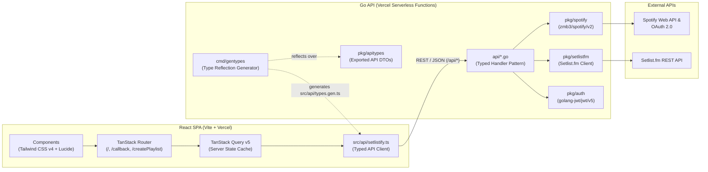

# Architecture

## System Overview

**Setlistify** is a full-stack web application that bridges **Spotify** and **Setlist.fm**. Users authenticate with their Spotify account, search for an artist, choose one of the artist's past concert setlists, and generate a Spotify playlist containing the songs performed at that concert.



---

## Technology Stack

### Frontend (`/src`)
* **Language**: TypeScript (`^5.7.0`)
* **Build Tool & Bundler**: Vite 6 (`^6.1.0`)
* **Framework**: React 19 (`^19.0.0`)
* **Routing**: TanStack Router (`@tanstack/react-router` `^1.111.0`, code-based routing)
* **Server State Management**: TanStack Query v5 (`@tanstack/react-query` `^5.66.0`)
* **Type Generation**: Go reflection generator (`cmd/gentypes`) emitting `src/api/types.gen.ts`
* **UI Styling**: Tailwind CSS v4 (`@tailwindcss/vite`) + native HTML elements + `lucide-react` icons
* **Testing**: Vitest (`^3.0.5`) + Testing Library (`@testing-library/react` `^16.2.0`, `jsdom`)
* **Runtime & Package Management**: Node.js 22 (`.nvmrc`), Yarn 4 (`yarn@4.17.0`)

### Backend (`/api`, `/pkg`)
* **Language & Runtime**: Go 1.22+ (`go.mod`)
* **Handler Architecture**: Typed Handler Pattern (pure domain functions wired through `httputil.Handle[Req, Res]` generic adapter)
* **Authentication**: `github.com/golang-jwt/jwt/v5` for HS256-signed JWT tokens
* **External SDKs**:
  * `github.com/zmb3/spotify/v2` & `golang.org/x/oauth2` — Spotify OAuth2 and Web API client
  * Native HTTP client for Setlist.fm REST API (`pkg/setlistfm`)
* **Local Dev Server**: `cmd/devserver/main.go`
* **Type Generator**: `cmd/gentypes/main.go`

### Hosting & Infrastructure
* **Vercel Monorepo**: Hosts both the frontend static build and the backend Go serverless functions under `https://www.setlistify.app`.
  * **Frontend**: React SPA built via `yarn build` (`tsc -b && vite build`) into `/build`.
  * **Backend**: Serverless Functions in `/api` compiled by Vercel's Go builder.
  * **Routing & Headers**: Configured via `vercel.json` for client-side routing rewrites and API CORS policies.

---

## Core Architectural Patterns

### 1. Client-Side Routing & Authentication Flow
Routing is managed in `src/components/app_routing.tsx` using `@tanstack/react-router`:
1. **`/` (Landing / Login)**:
   * Consumes `GET /api/authUrl` via TanStack Query (`useQuery({ queryKey: ['authUrl'] })`).
   * The backend generates a Spotify OAuth authorization URL and returns `{ authUrl, cachePath }`.
   * Unauthenticated users see `<Login />` with a button linking to Spotify's OAuth authorization page.
2. **`/callback` (OAuth Callback)**:
   * Spotify redirects back to `/callback?code=...`.
   * Route search parameter `code` is type-safely parsed with TanStack Router's `validateSearch`.
   * `<LoginHandler />` executes `useQuery({ queryKey: ['getUser', code], queryFn: () => exchangeCodeForUser({ code }), staleTime: Infinity, retry: false })`.
   * The backend exchanges the authorization code for a Spotify access token, encodes the token payload as an HS256 JWT signed with `APP_SECRET_KEY`, fetches the current Spotify user profile, and returns `{ user, token }`.
   * The client stores `user` and `token` in React state and navigates to `/createPlaylist`.
3. **`/createPlaylist` (Main Application View)**:
   * Protected by `isLoggedIn` router context (redirects to `/` if unauthenticated).
   * Renders `<CreatePlaylistContainer token={token} />`.

### 2. Auto-Synced Backend & Frontend Types (`cmd/gentypes`)
Backend API request and response DTO structs are declared in `pkg/apitypes/types.go`.
Running `yarn gen:types` (`go run ./cmd/gentypes`) uses Go reflection to walk the Go struct hierarchy (including nested types from `pkg/setlistfm` and `github.com/zmb3/spotify/v2`) and emit `src/api/types.gen.ts`.
Zero type drift is enforced in CI via `go run ./cmd/gentypes && git diff --exit-code src/api/types.gen.ts`.

### 3. Artist Search & Setlist Disambiguation
Because artist names on Spotify and Setlist.fm can collide across multiple acts or venues:
1. **Autocomplete (`POST /api/artistSearch`)**: Queries Spotify's search API (`artist:<query>`) via TanStack Query (`queryKey: ['artistSearch', searchQuery, token]`), rendering an accessible custom combobox dropdown.
2. **Setlist Resolution (`POST /api/artistSetlists`)**:
   * Queries Setlist.fm artists via TanStack Query (`queryKey: ['artistSetlists', selectedArtistName]`).
   * Prioritizes exact case-insensitive name matches and inspects candidate MusicBrainz IDs (`mbid`) to find a candidate with non-empty song setlists.
   * Returns `{ artistSetlists, artistMbid }` so the frontend retains the resolved `artistMbid` for playlist generation.

### 4. Playlist Generation (`POST /api/buildPlaylist`)
1. Executed via TanStack Query `useMutation` (`mutationFn: buildPlaylist`).
2. Receives `{ token, artistName, artistId, playlistType, playlistId, artistMbid }`.
3. Decodes the JWT via `pkg/auth` to retrieve the user's Spotify access token.
4. Fetches the specific concert directly by its Setlist.fm ID via `pkg/setlistfm` and flattens songs across all sets and encores.
5. Creates a new public playlist named `"<Artist>'s Setlist from <Date>"` on the user's Spotify account via `pkg/spotify`.
6. Resolves each song title + artist name to a Spotify track URI and adds all matched tracks to the created playlist, returning `{ playlistUri }`.

### 5. Environment & API Boundary (`dev` vs `prod`)
* **Unified Same-Origin Routing**: `src/utils/dev_env.ts` exports `fetchUrl()`, which returns `'/api'`.
  * In production on Vercel, requests to `/api/*` are handled directly by the corresponding Go serverless functions in `api/`.
  * In local development, `vite.config.ts` proxies `/api/*` requests to the Go dev server (`http://localhost:5001`) and listens on `http://127.0.0.1:3000`.
* **Stateless Token-Based Backend**:
  * The Go backend is completely stateless; no server-side sessions, temporary files, or local OAuth token caches are required. User credentials and access tokens are passed via client JWTs signed with `APP_SECRET_KEY`.

### 6. Go Serverless Handler Architecture (Typed Handler Pattern)
The Go Vercel serverless functions in `api/*.go` separate HTTP transport lifecycle concerns from pure domain logic:
1. **Generic Handler Adapter (`pkg/httputil/adapter.go`)**:
   - `httputil.Handle[Req, Res](method, fn)` wraps a pure business logic function `func(ctx, cfg, req) (res, error)`.
   - Automates CORS preflight (OPTIONS 204), HTTP method checks (405), configuration loading, JSON decoding for non-GET requests (400), and structured error/success JSON writing.
   - Translates `httputil.APIError` into specific HTTP status codes and error type payloads (falling back to 500 `ServerError`).
2. **Pure Domain Functions**:
   - Reside in the `api/` package alongside the exported entry point (e.g. `resolveArtistSetlists`, `searchArtists`, `buildPlaylist`).
   - Accept typed DTO requests, context, and config; return typed DTO responses and errors.
   - Fully testable in isolation without mocking `http.ResponseWriter` or HTTP request streams.
3. **Vercel Entry Points**:
   - Retain standard signature `func(w http.ResponseWriter, r *http.Request)`.
   - Single-line delegates to `httputil.Handle(method, businessFunc)(w, r)`.

---

## Directory Structure

```text
setlistify-app/
├── .agents/
│   └── skills -> ~/Documents/develop/.agents/skills # Symlink to shared skills repo
├── .github/
│   └── workflows/                     # GitHub Actions CI workflows
├── api/                               # Go Vercel serverless entry points (Typed Handler Pattern)
│   ├── artistSearch.go
│   ├── artistSetlists.go
│   ├── authUrl.go
│   ├── buildPlaylist.go
│   ├── getUser.go
│   ├── setlistArtists.go
│   └── handlers_test.go
├── cmd/
│   ├── devserver/                     # Local standalone Go dev server
│   └── gentypes/                      # TypeScript type generation from Go DTO structs
├── pkg/
│   ├── apitypes/                      # Shared Go API request/response DTOs
│   ├── auth/                          # JWT token encoding & decoding
│   ├── config/                        # Environment & config loading
│   ├── httputil/                      # CORS, JSON, and generic adapter Handle[Req, Res]
│   ├── setlistfm/                     # Setlist.fm client & setlist resolution
│   └── spotify/                       # Spotify service, user client, & playlist creation
├── plans/                             # Feature and refactoring plans
├── index.html                         # Vite root HTML entry point
├── src/
│   ├── api/
│   │   ├── types.gen.ts               # Auto-generated TypeScript types (via cmd/gentypes)
│   │   └── setlistify.ts              # Typed API client fetch functions
│   ├── components/
│   │   ├── app_routing.tsx            # TanStack Router routes & TanStack Query authUrl fetch
│   │   ├── artist_card.tsx            # Selected artist summary card (Tailwind CSS v4)
│   │   ├── basic_header.tsx           # Simple header component
│   │   ├── create_playlist_container.tsx # Playlist creation workflow (useMutation)
│   │   ├── error_message.tsx          # Accessible error alert component
│   │   ├── footer.tsx                 # Page footer component
│   │   ├── header_card.tsx            # Top navigation/user header card
│   │   ├── loading_placeholder.tsx    # Tailwind CSS loading skeleton & spinner
│   │   ├── login.tsx                  # Landing view with Spotify login button
│   │   ├── login_handler.tsx          # /callback OAuth code exchange (useQuery)
│   │   ├── not_found.tsx              # 404 route fallback
│   │   ├── playlist_builder_buttons.tsx # Native select & playlist submit button
│   │   └── search_container.tsx       # Custom combobox & concert select dropdowns
│   ├── img/
│   │   └── logo.png                   # Setlistify brand logo
│   ├── utils/
│   │   └── dev_env.ts                 # API base URL helper (dev proxy vs prod)
│   ├── App.css                        # App layout styles
│   ├── App.test.tsx                   # Vitest unit test suite
│   ├── App.tsx                        # Top-level App shell & QueryClientProvider
│   ├── index.css                      # Tailwind CSS v4 entry point (@import "tailwindcss";)
│   ├── index.tsx                      # React 19 createRoot mounting entry point
│   └── setupTests.ts                  # Testing library vitest matchers setup
├── vercel.json                        # Vercel deployment, rewrites, and headers
├── vite.config.ts                     # Vite 6 + Tailwind CSS v4 + Vitest configuration
├── ARCHITECTURE.md
├── go.mod
├── package.json
└── tsconfig.json
```
