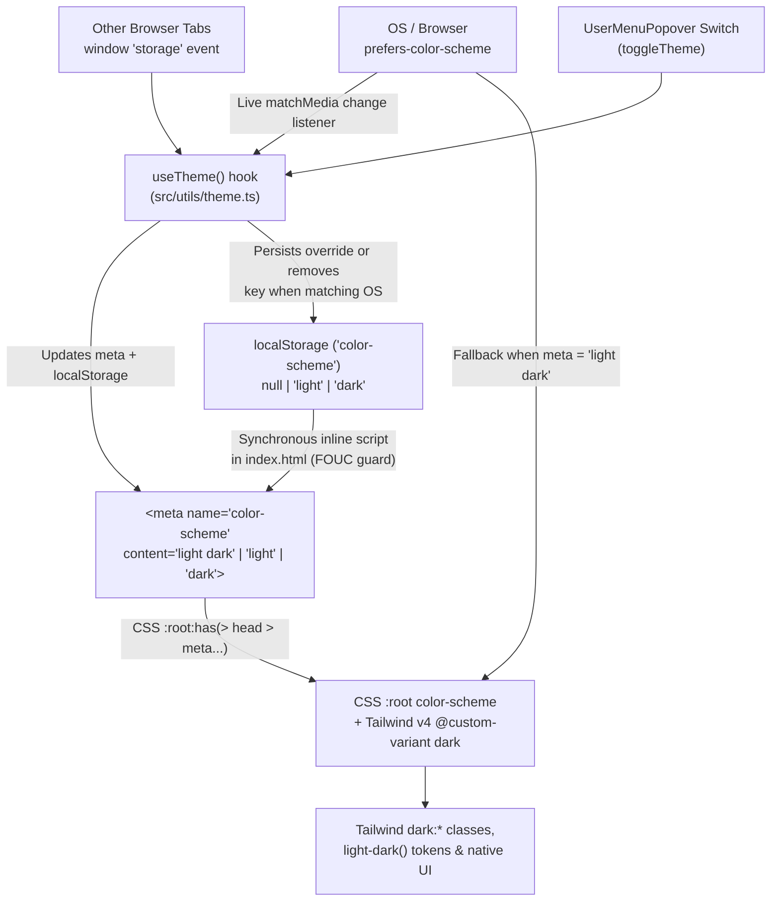

# Plan: Light/Dark Mode with OS Default and User Menu Toggle

- **Date:** 2026-11-21
- **Status:** approved

## 1. Overview

Add first-class light and dark mode support across the Setlistify UI, defaulting to the user's operating system / browser preference (`prefers-color-scheme`) and providing an accessible two-state dark mode toggle switch inside [`UserMenuPopover`](file:///Users/alexcaulfield/src/setlistify/src/components/user-menu-popover.tsx).

### Objectives
- **OS/Browser Default with Zero FOUC:** Respect the system color scheme by default across all routes (including unauthenticated `/` and `/callback` views) and apply any persisted user override synchronously before first paint.
- **Smart Two-State Toggle in User Menu:** Expose a zero-dependency accessible toggle switch (`<input type="checkbox" role="switch">`) inside [`UserMenuPopover`](file:///Users/alexcaulfield/src/setlistify/src/components/user-menu-popover.tsx) that overrides the system theme when flipped away from the OS preference and reverts cleanly to following the OS when flipped back to match it.
- **Native + Custom UI Cohesion:** Use HTML `<meta name="color-scheme" content="light dark">` and CSS `color-scheme` on `:root` so both custom Tailwind components and native browser UI (scrollbars, `<select>` dropdowns, canvas background) match seamlessly.
- **Neutral Charcoal Dark Aesthetic:** Apply a Spotify-inspired neutral dark palette (`neutral-950` canvas, `neutral-900` elevated surfaces, `neutral-800` borders, emerald/Spotify green accents) and frame the black-ink [`logo.png`](file:///Users/alexcaulfield/src/setlistify/src/img/logo.png) in a soft light rounded card in dark mode.
- **Strict Styling & Zero-Dependency Discipline:** Follow [`AGENTS.md`](file:///Users/alexcaulfield/src/setlistify/AGENTS.md) (Tailwind utilities + co-located `.css` files, no inline styles) and introduce zero new npm dependencies.

---

## 2. Architectural Decisions

### 2.1 Alignment with [`ARCHITECTURE.md`](file:///Users/alexcaulfield/src/setlistify/ARCHITECTURE.md) & [`AGENTS.md`](file:///Users/alexcaulfield/src/setlistify/AGENTS.md)
- **Frontend-Only Scope:** No Go backend (`/api`, `/pkg`) or `tygo` generated type changes are required.
- **Zero-Primitive / Zero-Dependency UI:** Matches Setlistify's Tailwind CSS v4 + native HTML + Lucide architecture by building the switch with a native `<input type="checkbox" role="switch">` styled in [`user-menu-popover.css`](file:///Users/alexcaulfield/src/setlistify/src/components/user-menu-popover.css) (skipping `input-switch-polyfill` per user preference).
- **No Inline Styles:** All custom CSS rules (`color-scheme`, `@custom-variant dark`, `light-dark()` tokens, and the switch track/thumb styles) live in [`src/index.css`](file:///Users/alexcaulfield/src/setlistify/src/index.css) and [`src/components/user-menu-popover.css`](file:///Users/alexcaulfield/src/setlistify/src/components/user-menu-popover.css).

### 2.2 Theme State & `<meta name="color-scheme">` Architecture
Instead of relying exclusively on a JS-managed `.dark` class (which breaks if JS fails to run), `<meta name="color-scheme">` is the single source of truth read by both CSS and the browser's native UI engine:



### 2.3 Two-State Toggle Semantics (Smart Revert to System)
Per modern dark-mode toggle best practices, the stored value uses three internal states (`null` = system, `'light'`, `'dark'`) presented through a simple 2-state switch:
1. **Rendered scheme** = `storedTheme ?? systemScheme`. The switch's `checked` state reflects `rendered === 'dark'`.
2. **On toggle**, `target = rendered === 'dark' ? 'light' : 'dark'`:
   - If `target !== systemScheme`: save `target` to `localStorage` (`color-scheme`) and set `<meta name="color-scheme">` to `target`.
   - If `target === systemScheme`: **remove** the `localStorage` entry and set `<meta name="color-scheme">` back to `"light dark"` so future OS changes take effect automatically.
3. **No retroactive clearing:** If the user pins `'dark'` while OS is light, and the OS later switches to dark at sunset, the stored `'dark'` override is kept so the user's explicit pin isn't silently discarded.
4. **Resilient storage:** All `localStorage` calls are wrapped in `try/catch` (matching [`src/utils/auth.ts`](file:///Users/alexcaulfield/src/setlistify/src/utils/auth.ts)); if storage is blocked, the theme still updates in memory and on `<meta>`.
5. **Menu ergonomics:** Toggling the switch inside [`UserMenuPopover`](file:///Users/alexcaulfield/src/setlistify/src/components/user-menu-popover.tsx) keeps the popover open so the user gets immediate visual feedback, whereas clicking `Log out` still dismisses the popover.

### 2.4 Tailwind CSS v4 `@custom-variant dark` Integration
By default, Tailwind v4's `dark:` variant only checks `@media (prefers-color-scheme: dark)`. Defining a custom variant in [`src/index.css`](file:///Users/alexcaulfield/src/setlistify/src/index.css) ties every `dark:*` utility directly to `<meta name="color-scheme">` + OS preference without needing a `.dark` class on `<html>`:

```css
@custom-variant dark {
  &:where(:root:has(> head > meta[name="color-scheme"][content="dark"]), :root:has(> head > meta[name="color-scheme"][content="dark"]) *) {
    @slot;
  }
  @media (prefers-color-scheme: dark) {
    &:where(:root:not(:has(> head > meta[name="color-scheme"][content="light"])), :root:not(:has(> head > meta[name="color-scheme"][content="light"])) *) {
      @slot;
    }
  }
}
```

### 2.5 Dark Mode Palette (Neutral Charcoal / Spotify-Inspired)

| Surface / Role | Light Mode | Dark Mode |
|---|---|---|
| Page canvas | `bg-gray-50` (`#f9fafb`) | `dark:bg-neutral-950` (`#0a0a0a`) |
| Primary cards / Nav / Footer / Popover | `bg-white` (`#ffffff`) | `dark:bg-neutral-900` (`#171717`) |
| Borders / Dividers | `border-gray-100` / `border-gray-200` / `border-gray-300` | `dark:border-neutral-800` / `dark:border-neutral-700` |
| Primary text | `text-gray-900` | `dark:text-neutral-100` |
| Secondary / muted text | `text-gray-600` / `text-gray-500` | `dark:text-neutral-300` / `dark:text-neutral-400` |
| Brand / Accent | `emerald-600`, Spotify `#1DB954` | `dark:text-emerald-400`, `emerald-600` / `hover:bg-emerald-500`, Spotify `#1DB954` |
| Disabled controls | `bg-gray-300 text-gray-500` | `dark:bg-neutral-800 dark:text-neutral-500` |
| Error alert | `bg-red-50 border-red-200 text-red-800` | `dark:bg-red-950/50 dark:border-red-900/60 dark:text-red-300` |
| Login logo ([`logo.png`](file:///Users/alexcaulfield/src/setlistify/src/img/logo.png)) | Direct image | Soft light rounded card (`dark:rounded-2xl dark:bg-neutral-100 dark:p-4 dark:shadow-lg dark:ring-1 dark:ring-white/10`) |

---

## 3. Step-by-Step Implementation Details

### Phase 1: HTML FOUC Guard & Root CSS Configuration
- [ ] **Task 1.1: Update [`index.html`](file:///Users/alexcaulfield/src/setlistify/index.html)**
  - Add `<meta name="color-scheme" content="light dark" />` in `<head>`.
  - Immediately after it, add a minimal synchronous inline `<script>` (no `defer`, no `type="module"`) wrapped in `try/catch` that reads `localStorage.getItem('color-scheme')` and, if `'light'` or `'dark'`, sets `meta.content` before first paint.
  - Replace the single hardcoded `<meta name="theme-color" content="#000000" />` with light/dark media-matched `theme-color` tags (`#fafafa` for light, `#0a0a0a` for dark).

- [ ] **Task 1.2: Update [`src/index.css`](file:///Users/alexcaulfield/src/setlistify/src/index.css)**
  - Declare `@custom-variant dark` keyed on `<meta name="color-scheme">` and `@media (prefers-color-scheme: dark)`.
  - Configure `:root` with `color-scheme: light dark;` and `:has(> head > meta[name="color-scheme"][content="dark"|"light"])` overrides so native UI (scrollbars, `<select>` options, canvas) always matches the active scheme.

---

### Phase 2: Theme State Utility & React Hook
- [ ] **Task 2.1: Create `src/utils/theme.ts`**
  - Export `THEME_STORAGE_KEY = 'color-scheme'` and types `ThemeScheme = 'light' | 'dark'`, `StoredTheme = ThemeScheme | null`.
  - Implement pure, testable helpers: `getSystemScheme`, `getStoredTheme`, `resolveTheme`, `applyThemeMeta`, `toggleThemePreference`.
  - Export `useTheme()` hook.

- [ ] **Task 2.2: Update [`src/setupTests.ts`](file:///Users/alexcaulfield/src/setlistify/src/setupTests.ts)**
  - Add a default `window.matchMedia` stub if undefined in `jsdom` (returning `matches: false` and no-op `addEventListener`/`removeEventListener`) so all component tests run cleanly.

---

### Phase 3: Accessible Toggle Switch in User Menu Popover
- [ ] **Task 3.1: Update [`src/components/user-menu-popover.css`](file:///Users/alexcaulfield/src/setlistify/src/components/user-menu-popover.css)**
  - Replace hardcoded `white` / `#e5e7eb` popover surface with light/dark CSS custom properties using `@media (prefers-color-scheme: dark)`, `:root:has(> head > meta[name="color-scheme"][content="dark"|"light"])`, and `@supports (color: light-dark(white, black))` progressive enhancement.
  - Increase `.user-menu-popover` `min-width` to `12rem` so the switch label and control sit comfortably on one row.
  - Add zero-dependency `.theme-switch` CSS rules for `<input type="checkbox" role="switch">`.

- [ ] **Task 3.2: Update [`src/components/user-menu-popover.tsx`](file:///Users/alexcaulfield/src/setlistify/src/components/user-menu-popover.tsx)**
  - Call `useTheme()` inside `UserMenuPopover` and render the `Dark mode` switch row above `Log out`.

---

### Phase 4: Dark Mode Styling Across All UI Components
- [ ] **Task 4.1: App Shell, Navigation & Footer** (`App.tsx`, `nav-bar.tsx`, `footer.tsx`, `basic_header.tsx`)
- [ ] **Task 4.2: Login, Loading & Error States** (`login.tsx`, `loading_placeholder.tsx`, `error_message.tsx`, `not_found.tsx`)
- [ ] **Task 4.3: Playlist Creation Flow** (`search_container.tsx`, `playlist-builder-buttons.tsx`, `create-playlist-container.tsx`, `artist_card.tsx`)

---

### Phase 5: Unit Tests & Plan Archival
- [ ] **Task 5.1: Add Unit Tests** (`src/utils/theme.test.ts`, `src/components/user-menu-popover.test.tsx`)
- [ ] **Task 5.2: Save Approved Plan** (`/plans/2026-11-21-light-dark-mode.md` with status `approved`)

---

## 4. Verification Plan

### Automated Tests
```bash
yarn test
yarn build
```

### Manual Verification
1. Start the local dev servers (`go run ./cmd/devserver` and `yarn start`) and open `http://127.0.0.1:3000`.
2. **OS Default (Unauthenticated):** Toggle OS / DevTools `prefers-color-scheme` between `light` and `dark` on `/` (Login page). Verify the page switches live, `logo.png` is framed cleanly in a soft light rounded card in dark mode, and no toggle appears in the header.
3. **Toggle Switch (Authenticated):** Log in, open the user menu popover, and verify:
   - The `Dark mode` switch reflects the current OS theme.
   - Toggling away from OS switches the entire UI immediately while keeping the popover open.
   - Reloading the page renders directly in the chosen theme with zero white/dark flash.
   - Toggling back to match the OS clears `localStorage.getItem('color-scheme')` and restores `<meta name="color-scheme" content="light dark">`.
4. **Cross-Tab Sync & Keyboard Accessibility:** Verify two-tab sync and keyboard `Tab` / `Space` operation.
